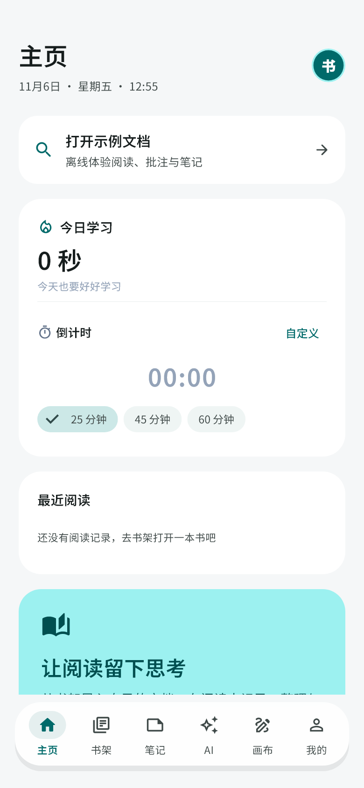
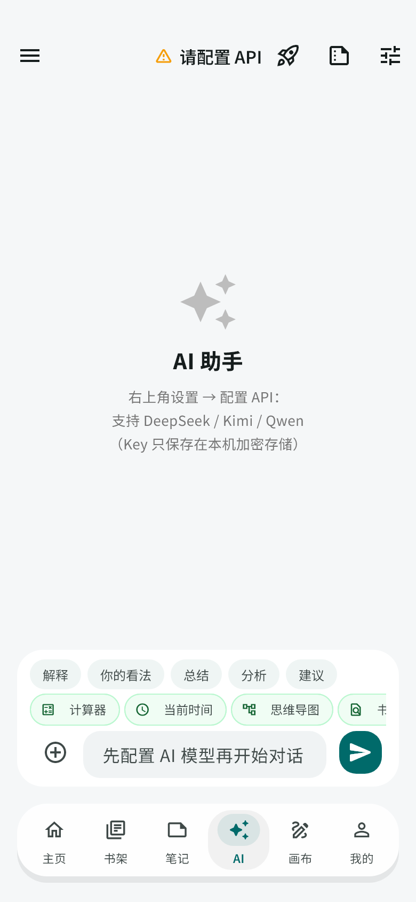
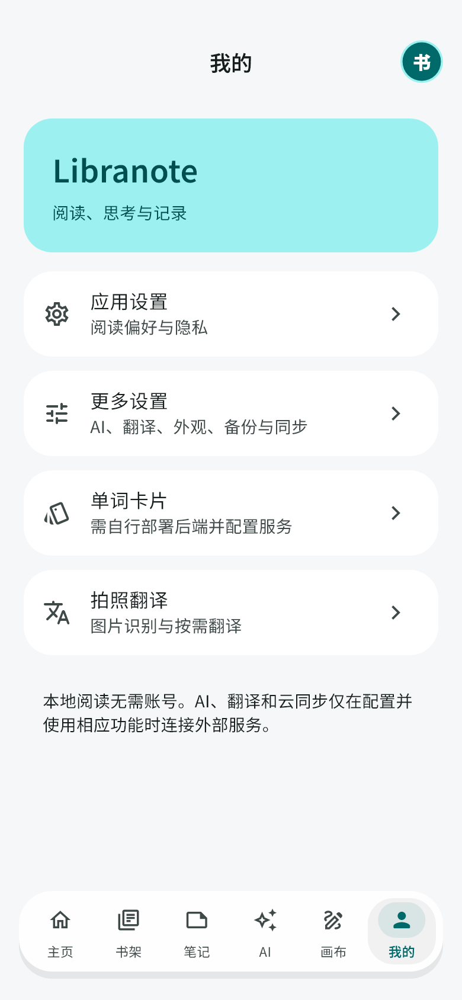

# Libranote · 阅读与笔记

面向 **Android / Windows** 的 Flutter 个人实践项目，将本地文档阅读、批注笔记、画布和可配置 AI 服务整合到一个应用中。

借助 AI 辅助进行功能开发、界面实现、问题排查与测试。本仓库为公开展示版，重点展示客户端工程实现；无需书库账号即可进入，内置原创离线示例文档。

**快速体验：启动 App → 打开示例文档 → 阅读与批注 → 到笔记中心回顾。**

## 界面预览

以下为 Flutter 组件测试生成的界面截图，使用空书架测试数据；不是实际手机拍摄。

| 阅读主页 | AI 中心 | 个人与设置 |
|---|---|---|
|  |  |  |

采用悬浮底部导航、统一圆角和深浅主题；导航在键盘弹出时收起，为输入区域保留空间。

## 功能与技术

| 模块 | 已有实现 | 主要技术 |
|---|---|---|
| 本地书架 | 文件导入、文件夹、标签、排序、阅读进度 | SQLite、文件存储、Riverpod |
| 多格式阅读 | EPUB、PDF、TXT、Markdown、DOCX；目录与续读 | WebView / foliate-js、pdfrx、文档解析 |
| 批注与笔记 | 文本高亮、格式对应的批注、PDF 手写、DOCX 编辑、集中查看与导出 | 结构化锚点、SQLite、文件导出 |
| AI 与任务 | 可配置模型服务、流式对话、附件、工具调用、任务计划与取消 | Dio、工具注册、状态持久化 |
| MCP | HTTP 与桌面 stdio 连接、工具发现与调用 | JSON-RPC、进程和网络通信 |
| 画布与备忘录 | 原生画布的笔迹、文本、图片、表格与本地保存；JSON 导入导出 | Flutter Canvas、交互变换、SQLite |
| 备份与学习辅助 | WebDAV 备份/恢复、朗读、翻译、学习计时；可选拍照单词卡片后端 | WebDAV、TTS、ML Kit、Python / Flask |

“已有实现”描述代码范围，不代表所有设备与外部服务均已验收。AI、翻译、WebDAV 和单词卡片需使用者配置自己的服务；仓库不附带账号或密钥。

## 实现中关注的问题

- **阅读进度与笔记关联：** 用稳定文件标识关联文档和批注；重新导入时更新书架记录，避免 SQLite REPLACE 引发级联删除。
- **Agent 生命周期：** 将任务状态写入本地存储，区分进程重启恢复与页面切换；取消信号传递到模型请求和执行步骤。
- **文档差异：** EPUB 使用正文顺序与位置锚点；PDF、DOCX 使用各自的页码或段落位置处理阅读及批注。
- **界面与异步状态：** 用 Riverpod 管理服务和页面状态，校验窄屏、安全区、键盘和主题切换；防止页面退出后继续访问已销毁的状态。
- **新装与升级一致性：** 同时检查建表和迁移路径，补齐学习统计表在新装数据库中的初始化。

## 本地运行

验证环境：Flutter **3.44.9** / Dart **3.12.2**。请先安装 Flutter、Android SDK 或 Windows C++ 桌面开发工具链。

```powershell
git clone https://github.com/zzy19074244935-dot/libranote.git
cd libranote
flutter pub get
flutter analyze
flutter test
flutter devices
flutter run -d <设备ID>
```

Windows 可运行 `flutter run -d windows`；Android 连接开启 USB 调试的设备后，选择对应设备 ID。

首次构建需要下载依赖和 PDFium 原生库。若 GitHub Releases 无法访问，原生库下载会失败；详见 [依赖兼容说明](third_party/README.md)。项目将历史兼容依赖显式保存在 `third_party/`，无需修改全局 Pub 缓存。

Android 调试构建：

```powershell
flutter build apk --debug --target-platform android-arm64
```

正式分发应配置自己的 release 签名。未配置签名时 release 构建使用开发用 debug 签名，仅用于本地体验。签名文件和 `key.properties` 不提交到仓库。当前没有发布 GitHub Release 安装包。

## 代码结构

```text
lib/
  config/       外观与本地偏好
  models/       文档、批注、画布和任务模型
  providers/    服务依赖与页面状态
  screens/      阅读器、笔记、AI、任务及设置页面
  services/     SQLite、文档处理、AI、MCP、同步和导出
  widgets/      导航、阅读视图与公共组件
assets/reader/  WebView 阅读引擎及其第三方资源
assets/demo/    原创离线示例
third_party/    显式兼容依赖与许可证
serverless/     可选的拍照单词卡片后端
test/           本地逻辑、文档、数据库和界面测试
tool/e2e/       WebView 阅读引擎验证脚本
```

## 验证与边界

本轮验证记录见 [验证说明](docs/验证说明.md)。测试覆盖 Agent 生命周期与取消、文档处理、数据库迁移、示例重复打开、浮动导航、安全区及主题切换。

当前仍有可继续改进的部分：跨设备 WebDAV 冲突验证、更多真实文档回归、外部模型与 MCP 的权限体验统一，以及 Android 不同机型的兼容性。主要目标平台为 Android 和 Windows；其他平台脚手架不代表已通过测试。

## 说明与致谢

- [使用说明](docs/使用说明.md)
- [第三方组件与许可](THIRD_PARTY_NOTICES.md)
- [依赖兼容说明](third_party/README.md)
- [可选后端部署](serverless/部署指引.md)

文档阅读引擎、PDF 库、字体和依赖包的原作者及许可证见第三方声明。本项目不将这些引擎宣称为自研，也不将所有文件统一声明为 MIT。原创部分目前公开用于作品展示与代码审阅，暂未额外授予通用开源许可；第三方组件继续适用其原有许可证。
